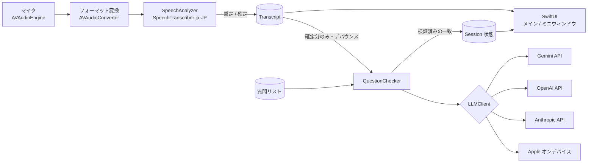

# AskTrack 設計書

- アプリ名: **AskTrack**（Ask + Track）
- 作成日: 2026-11-24
- 対象: Apple Silicon Mac / macOS 26 以降
- リポジトリ: https://github.com/h-sgy/AskTrack （public、MIT ライセンス）

---

## 1. 概要

インタビュー・ヒアリング中の音声をリアルタイムで文字起こしし、事前に登録した質問リストのうち **「もう聞いた質問」を自動でチェックする** macOS アプリ。目的は聞き漏れを防ぐこと。

主な利用場面は**対面**のインタビュー・ヒアリング。オンライン会議での利用は二次的な位置づけとする。

---

## 2. 要件

### 2.1 機能要件

| # | 要件 | フェーズ |
|---|---|---|
| F1 | マイク音声をリアルタイムで日本語文字起こし | MVP |
| F2 | 質問リストの登録・編集（1行1質問のテキスト貼り付けに対応） | MVP |
| F3 | 文字起こしを監視し、聞いた質問を自動でチェック（根拠となる発言つき） | MVP |
| F4 | チェックの手動 ON/OFF（誤判定の修正） | MVP |
| F5 | 使う LLM をユーザーが選べる。API キーはユーザーが設定 | MVP |
| F6 | 自動アップデート | MVP（**最初の配布版から必須**） |
| F7 | 未チェックの質問だけを表示する、常に最前面のミニウィンドウ | MVP |
| F8 | セッション（文字起こし＋チェック結果）の保存と Markdown 書き出し | MVP |
| F9 | システム音声（Zoom / Meet の相手側の声）の取り込み | Phase 3 |
| F10 | サブスクでの LLM 利用（Apple PCC / ChatGPT プラン） | Phase 2〜3 |
| F11 | 録音の一時停止と再開（一時停止中はマイクを止め、その時間は録音時間に含めない） | MVP |

### 2.2 非機能要件

- **遅延**: 発話してからチェックが付くまで 30 秒以内（内訳は 5.1）
- **プライバシー**: 音声は保存しない。テキストだけをローカルに保存する。外部 LLM を使っている間はその旨を UI に常時表示する
- **秘密情報**: API キーは Keychain にだけ保存する。アプリ本体には一切同梱しない
- **オフライン**: Apple のオンデバイス LLM を選べば、ネットワークなしで全機能が動く。ただし初回起動時だけ、音声認識モデルのダウンロードにネットワークが要る
- **データ保全**: 録音中にアプリが落ちても、確定済みの書き起こしとチェック結果は失われない（4.5）

---

## 3. 全体構成



使うのは Apple 純正フレームワークがほとんどで、外部依存は **Sparkle だけ**。

| コンポーネント | 役割 |
|---|---|
| `AudioCapture` | AVAudioEngine の入力にタップを付け、`AsyncStream<AVAudioPCMBuffer>` で流す |
| `Transcriber` | SpeechAnalyzer のラッパー。暫定結果と確定結果を `Segment` として流す |
| `QuestionChecker` | デバウンスしてから LLM を呼び、結果を検証してチェックを付ける |
| `LLMClient` | プロバイダを抽象化（Apple / Anthropic / OpenAI / Gemini の 4 実装） |
| `Store` | JSON ファイルの読み書き |
| `Keychain` | API キーの保存と取得（数十行） |
| Sparkle | 自動アップデート |

---

## 4. 技術選定

### 4.1 アプリ形態

- **SwiftUI のネイティブ macOS アプリ**。音声入力、音声認識、オンデバイス LLM がすべて Apple 純正で揃うので、Electron などを選ぶ理由がない
- **Developer ID 署名＋公証による直接配布**（Mac App Store は使わない。理由は 4.6）
- App Sandbox は使わない（Sparkle の構成が簡単になる）。公証に必須の Hardened Runtime は有効にする

### 4.2 音声入力

- **MVP: マイクのみ**（`AVAudioEngine.inputNode` にタップを付ける）
  - 対面が主なので、マイク 1 本に質問者（ユーザー）と回答者の両方の声が入る。「質問したか」の判定はマイクだけで成り立つ
  - 話者は区別できない（1 本のマイクに 2 人の声が混ざる）。回答者の発言を「質問した」と誤判定しないよう、プロンプトで補う（5.4）
  - 内蔵マイクだと、Mac から遠い回答者の声が小さくなりがち。Mac を 2 人の間に置くか、無指向性の外部マイクを使うよう案内する
  - **使うマイクは macOS の「サウンド > 入力」で選んでいるもの**。アプリの中では選ばない。設定画面には今使っているマイクの名前と「サウンド設定を開く」ボタン、録音画面にはマイクの名前を出す
    - アプリの中で選ぶ方式（入力ノードの AUHAL に `kAudioOutputUnitProperty_CurrentDevice` を設定する）は実機で試してやめた（2026-11-25）。入力専用のマイク（内蔵マイクなど）を指定すると音声が届かなくなり、`setDeviceID` ではエンジンの起動が固まった。AVAudioEngine は入力と出力で 1 つの AUHAL を共有しているためとみられる。アプリの中で選び分ける必要が出たら、AVCaptureSession で取り込む方式にする
  - **入力デバイスの切り替えに追従する**: 次のどれかが起きたら、流れ（`AsyncStream`）を閉じずに **AVAudioEngine を作り直して**つなぎ直し、画面に知らせる（作り直したエンジンは、その時点の既定の入力を使う）
    - `AVAudioEngineConfigurationChange`（AirPods の接続・切断などでエンジンが止まったとき）
    - 既定の入力の変更（Core Audio の `kAudioHardwarePropertyDefaultInputDevice` を監視する。動いているエンジンは自動では追従しないため）
    - 一時停止中にマイクが変わっていたら、再開するときにつなぎ直す
    - 実機（内蔵マイク）で、つなぎ直しても音声が途切れず流れ続けること、一時停止中は流れないことを確認済み
  - 会議アプリが AirPods のマイクを使うと、AirPods は通話用の低音質モードに切り替わり、認識精度が落ちる。精度を重視するなら、有線マイクか Mac 内蔵マイクを使うよう案内する
- **Phase 3: システム音声**（オンライン会議で相手の声も文字起こししたい場合）
  - Core Audio Process Tap（`CATapDescription` と `AudioHardwareCreateProcessTap`。macOS 14.4 以降）を使う
  - ScreenCaptureKit と違って画面収録の権限が要らない。必要なのは `NSAudioCaptureUsageDescription` だけ
  - マイクとシステム音声を別々の Transcriber に流せば、話者（自分か相手か）が自然に分かれる

### 4.3 文字起こし: SpeechAnalyzer + SpeechTranscriber（macOS 26、Speech framework）

- 完全にオンデバイスで動き、無料。長時間の連続認識向けの新 API で、日本語に対応している
- 結果は **volatile（暫定）** と **final（確定）** の 2 種類。UI では暫定をグレーで出す。判定には確定セグメントに加えて、暫定の文を「認識中」の行として最後に付けて送る（5.1・5.2）
- **認識精度は高くない前提で設計する**。誤認識の読み替え（同音異義語、聞き間違い）は LLM に任せる（5.4）
- 実装メモ
  - 言語モデルは初回にダウンロードが必要: `AssetInventory.assetInstallationRequest(supporting: [transcriber])`
  - 入力フォーマットは `SpeechAnalyzer.bestAvailableAudioFormat(compatibleWith:)` に AVAudioConverter で合わせる
  - `attributeOptions: [.audioTimeRange]` で各セグメントのタイムスタンプを取る
  - 対応ロケールは実行時に `SpeechTranscriber.supportedLocales` で確認する（公式の言語一覧には誤記の報告がある）
  - 質問リストに出てくる固有名詞や専門用語を `AnalysisContext` の contextual strings として渡し、認識精度を上げる（要検証）
- 代替: 精度が足りなければ WhisperKit（ローカル Whisper）に差し替える。今は入れない

### 4.4 LLM プロバイダと認証

#### 調査結果（2026-11 時点）

| 方式 | 判定 | 内容 |
|---|---|---|
| Anthropic API キー | ○ **推奨（既定）** | ユーザーが Claude Console で発行したキーを設定する。誤認識の多い書き起こしから意図を読み取るには大型モデルが要る |
| Apple Foundation Models（オンデバイス） | △ 実験的（明示的に選んだときだけ） | キー不要・無料・オフラインで、外部に何も送らない。ただし**実測で判定精度が実用に届かなかった**（2026-11-25、対面インタビューの動画 4 分・質問 25 問。実際に聞いた 3 問をほぼ拾えず、先頭の質問に誤ってチェックが付いた。候補を 6 問に絞る方式、1 問ずつ聞く方式も改善しなかった）。結果も実行ごとに揺れる |
| OpenAI API キー | ○ 採用（MVP） | ユーザーが OpenAI Platform で発行したキーを設定する |
| Gemini API キー | ○ 採用（MVP） | ユーザーが Google AI Studio で発行したキーを設定する。**無料枠のキーだと、送った内容が Google の製品改善に使われる**ので、機密のヒアリングでは有料枠のキーが前提（設定画面と README で案内する） |
| Apple Private Cloud Compute（WWDC26） | ○ Phase 2 | API キー不要。初回ダウンロード 200 万未満のアプリなら開発者の負担は無料。ユーザーごとに 1 日の上限があり、**iCloud+ 加入者は上限が増える**。つまり実質「ユーザーの iCloud+ サブスクで動く」。macOS 27 以降を想定しており、詳細は要確認 |
| ChatGPT プランでサインイン（Sign in with ChatGPT） | △ Phase 3 | OpenAI が 2026 年に公式化した仕組みで、ユーザーの ChatGPT Plus / Pro などの利用枠で Responses API を呼べる。ただし現在は選ばれたパートナー向けの限定トライアルで、client ID の申請が必要 |
| Claude Pro / Max でログイン | ✗ **不可** | Anthropic が 2026 年 2 月に規約で明記した。サブスクの OAuth は Claude Code と Claude.ai 専用で、サードパーティ製品での利用や提供は禁止。4 月から強制されている |
| ローカルの `claude` CLI を子プロセスで呼ぶ | ✗ 非推奨 | 上の「サードパーティのハーネス」に当たるリスクがあるので、配布するアプリには載せない |

**実測（2026-11-25、対面インタビューの動画 4 分・質問 25 問。正解は 3 問）**

| 判定に使ったモデル | 聞いた区間（正解 3 問） | 聞いていない区間 |
|---|---|---|
| Apple オンデバイス | ほぼ拾えず、先頭の質問に誤チェック | 誤チェックなし |
| Gemini 3.5 Flash-Lite | 2 問 / 2 問 | 誤チェックなし |
| Gemini 3.8 Flash | 2 問 / 2 問 | 誤チェックなし |
| Gemini 4 Hydrogen | 2 問 / 3 問 | 誤チェックなし |
| Gemini 4 Argon | 3 問 / 2 問 | 誤チェックなし |

外部 LLM はどのモデルも誤チェックゼロで、取りこぼしたのは、相手の話に乗る形の曖昧な質問（1 問）だけだった。この規模では Flash-Lite で十分で、上位モデルは曖昧な質問を拾うことがある程度の差。Gemini 4 Argon は無料枠のキーでは使えない（上限 0）。

**結論**: サブスクで動かす方法は「Apple PCC（iCloud+）」と「ChatGPT サインイン（審査が通れば）」の 2 つ。Claude のサブスクは使えない。

#### 実装方針

```swift
protocol LLMClient {
    /// 書き起こしの中で尋ねられた質問を返す
    func findAsked(questions: [PromptQuestion], transcript: String) async throws -> [AskedMatch]
}
struct PromptQuestion { let key: String; let text: String }  // key は "q1", "q2" … の短い ID
struct AskedMatch: Decodable { let id: String; let segments: [String] }  // 5.3 のスキーマと同じ形
```

- 実装は `AppleLLM`、`AnthropicLLM`、`OpenAILLM`、`GeminiLLM` で、1 ファイルずつ
- 3 社とも Swift の公式 SDK がないので、**URLSession で REST API を直接呼ぶ**（各 60〜80 行程度）。HTTP 送信とエラーの分類は共通（`LLMHTTP`）
- 各社の違い
  - Anthropic: `output_config.format`（JSON Schema）と `effort: low`。Opus / Sonnet 5.5 は `fallbacks: "default"` も付ける（Haiku 5.5 は非対応）
  - OpenAI: Responses API の `text.format`（`strict: true`）と `reasoning.effort: low`。**`store: false`**（既定では応答が OpenAI 側に保存されるため）
  - Gemini: `responseJsonSchema` と `thinkingConfig.thinkingLevel: LOW`（Gemini 3 以降のみ。それより前のモデルに送るとエラー）。キーは URL ではなく `x-goog-api-key` ヘッダーで送る
- WWDC26 で Foundation Models に `LanguageModel` プロトコルが入り、Anthropic と Google が対応する Swift パッケージを出している。成熟していれば、自前の HTTP 層をやめてそちらに寄せる（Phase 2 で評価）
- **API キー**: Keychain に保存する（`kSecClassGenericPassword`、service は Bundle ID、account はプロバイダ名）。設定画面には SecureField と「接続テスト」ボタンを置く
- **モデル一覧**: 確認済みのモデルだけを固定の一覧（`Provider.swift`）で出す。API の一覧をそのまま出すと、構造化出力や思考の量のパラメータに対応しないモデルも選べてしまい、400 になるため
  - 既定は Anthropic が `claude-opus-5-5`（精度優先）、OpenAI が `gpt-6.2-sol`、Gemini が `gemini-3.8-flash`。T-20 の評価で見直す（コストは 5.7）
- Apple オンデバイスは `SystemLanguageModel.default.availability` で利用可否を確認する。Apple Intelligence がオフ、または非対応の言語設定なら、設定画面へ案内する
- API キーが未設定なら、**オンデバイスに黙って切り替えず**、判定はせずに文字起こしだけ行い、そのことを画面に出す（誤チェックは聞き漏れにつながるため）

### 4.5 データ保存

- **JSON ファイル（Codable）**。SwiftData は使わない。人が読めて、書き出しやバックアップもそのままできる
- 保存場所は `~/Library/Application Support/AskTrack/`
  - `lists/<uuid>.json`: 質問リスト
  - `sessions/<yyyyMMdd-HHmm>-<uuid>.json`: セッション
- **録音中は逐次保存する**: 確定セグメントが増えたとき、またはチェックが変わったときに、セッションのファイルを書き直す
  - 書き込みはアトミックにする（`Data.write(to:options: .atomic)`）。書き込み中に落ちても、ファイルが壊れない
  - 1 時間のセッションでも数百 KB 程度なので、毎回まるごと書き直してよい
  - 起動時に `endedAt` が空のセッションがあれば、録音中に落ちたものとして、過去のセッション一覧に「中断」と表示する
- 設定は UserDefaults に保存する（プロバイダ、モデル、判定の間隔、入力デバイス）。API キーだけは Keychain
- 音声は保存しない

### 4.6 自動アップデート: Sparkle 2

- Mac 直接配布では事実上の標準。SPM で導入する（`https://github.com/sparkle-project/Sparkle`）
- アプリ側の作業は少ない
  - `SPUStandardUpdaterController(startingUpdater: true, updaterDelegate: nil, userDriverDelegate: nil)` を App に持たせる
  - メニューに「アップデートを確認…」を追加する（`CommandGroup(after: .appInfo)`）
  - Info.plist に `SUFeedURL`（appcast.xml の URL）、`SUPublicEDKey`、`SUEnableAutomaticChecks = YES` を設定する
- 署名鍵: Sparkle の `generate_keys` で EdDSA 鍵を作る。秘密鍵はローカルの Keychain に置き、CI 用には `generate_keys -x` で書き出して GitHub Secrets に入れる
- **注意点**
  - Sparkle が新旧の比較に使うのは `CFBundleVersion`。リリースのたびに必ず増やす（`git rev-list --count HEAD` を使う）
  - リポジトリが public なので、配布は 1 リポジトリで完結させる。zip は GitHub Releases、appcast.xml は GitHub Pages（`gh-pages` ブランチ）に置き、`SUFeedURL` は `https://h-sgy.github.io/AskTrack/appcast.xml` にする
  - **Sparkle が入っていない版を配ってしまうと、その版のユーザーには以後アップデートが届かない**。そのため最初の配布版から入れる
  - Sparkle は MIT ライセンスなので、著作権表示をアプリに含める（「AskTrack について」の画面に出す `Credits.rtf`）
- Mac App Store を使わない理由: App Store なら自動アップデートは Apple がやってくれるが、審査のぶん配信が遅れ、サンドボックスの制約もある。「自分で即座にアップデートを配りたい」という要件には直接配布の方が合う

---

## 5. 質問チェックの詳細

### 5.1 実行タイミング

- 確定セグメントか暫定の文が届いたら **5 秒デバウンス**してから判定する。最短でも **15 秒** は間隔を空ける（設定で 5〜60 秒に変えられる）。話している間は、この間隔ごとに判定が走る
- 未チェックの質問がない、または録音を止めているときは呼ばない
- 判定中に次のきっかけが来たら、今の判定が終わってから 1 回だけ再実行する（並列には実行しない）
- 遅延の内訳（最悪の場合）: デバウンス 5 秒 ＋ 最短間隔の残り 最大 15 秒 ＋ LLM の応答 数秒 ≒ 25 秒。2.2 の要件はこれに合わせた
- 暫定の文も送る理由: 実測（動画の再生、2026-11-25）では、話し続けると音声認識が文を確定させるまで 1 文あたり中央値 15 秒・最長 21 秒かかった。確定だけを待つと、その分チェックが遅れる
- 新しい確定セグメントがなく暫定の文だけが伸びたときは、直前の重ね幅（5.2）と暫定の文を送る。暫定の文が前回の判定から変わっていなければ呼ばない。録音を止めたあとの判定では暫定の文を使わない

### 5.2 入力

- **質問**: チェック済みも含めて全部送り、済みの質問への結果は検証で捨てる（5.5）。ID は UUID ではなく `q1`〜`qN` の短い ID に置き換える（トークン節約と ID の取り違え防止）
  - 未チェックだけを送っていたときは、済みの質問に当たる発言（重ね幅で何度も送り直される）を、LLM が似た別の未チェックの質問に当てはめてしまった。実録音の再判定（2026-11-25、10 問・4 分半、各 3 回）で、Gemini 3.5 Flash-Lite は未チェックだけだと 3 回とも誤チェックが出て、全部送ると 3 回とも誤りがなかった。3.8 Flash はどちらも誤りなし
- **書き起こし**: 確定セグメントの各行の頭に、`[s12 03:15]` の形でセグメント ID（セッション内の連番）と時刻を付ける。暫定の文は、送る範囲が最新の確定セグメントまで届いているときだけ、最後に `[s13 認識中]` の行として付ける（ID は確定したときの番号と同じになる）
- **判定範囲**: 「どこまで判定に成功したか」を表す位置 `judgedUntil`（セグメント番号）を持ち、**`judgedUntil` より少し前から、最新の確定セグメントまで**を送る
  - 判定に成功したら、`judgedUntil` を送った範囲の最後まで進める。失敗したら（429 / 5xx / 通信エラー / refusal / 応答の解析失敗）進めない。こうすれば、失敗が続いても、その間の発言は次に成功した判定で必ず見られる
  - ただし、同じ範囲で refusal か解析失敗が 2 回続いたら、その範囲は飛ばして `judgedUntil` を進め、UI に「判定できなかった範囲」として表示する（同じ範囲で永久に詰まるのを防ぐ）
  - 前回の範囲と重ねる幅は、オンデバイスで 1 分、外部 LLM で 3 分。セグメントの境目をまたいだ質問も拾え、外部 LLM は前後の文脈が多いほど誤認識を読み解きやすい
  - 1 回に送る量には上限を設ける（オンデバイス 3 分、外部 LLM 10 分）。失敗が長く続いた後などで範囲が上限を超えたら、古い方から上限ごとに区切って順番に判定する
  - 日本語の会話 3 分は約 900 字で、オンデバイス LLM（約 4K トークン）にも収まる

### 5.3 出力スキーマ（全プロバイダ共通）

```json
{
  "type": "object",
  "properties": {
    "asked": {
      "type": "array",
      "items": {
        "type": "object",
        "properties": {
          "id":       { "type": "string", "description": "質問ID (q1..qN)" },
          "segments": { "type": "array", "items": { "type": "string" }, "description": "根拠となるセグメントID (s1..)" }
        },
        "required": ["id", "segments"],
        "additionalProperties": false
      }
    }
  },
  "required": ["asked"],
  "additionalProperties": false
}
```

Apple Foundation Models では、同じ形の構造体に `@Generable` を付けて `session.respond(to:generating:)` に渡す（ガイド付き生成）。コンテキストが溜まらないよう、**判定のたびに `LanguageModelSession` を新しく作る**。

### 5.4 プロンプト（system）

```
あなたはインタビュー進行のアシスタントです。
<questions> に質問リスト、<transcript> に会話の書き起こしが与えられます。
書き起こしは音声認識の結果で、誤認識を多く含みます（同音異義語、固有名詞やカタカナ語の崩れ、句読点の欠落、文の途中での分断など）。
文字面ではなく、音の近さと前後の文脈から、本来話された内容を推測して読んでください。
また、書き起こしには質問者と回答者の両方の発言が、話者の区別なしに混ざっています。
そのうえで、各質問が質問者によって「実質的に同じ意図で」既に尋ねられているかを判定してください。
- 言い回しが違っても、同じことを聞いていれば「尋ねた」とみなす
- 一部しか聞いていない、話題に触れただけ、という場合は含めない
- 回答者が自分から話題にしただけの場合や、回答者からの逆質問は含めない
- 確信が持てない場合は含めない
- 最後の「認識中」の行は、まだ話している途中の文です。途中まででも質問の意図がはっきりしていれば根拠にしてよい
尋ねた質問だけを返し、segments には根拠となる行のセグメント ID（[s12 …] の s12）を入れてください。
```

**判断を「確信がなければ返さない」側に倒す理由**: 誤ってチェックが付くと、ユーザーはその質問を聞いたつもりになって聞き漏れが起きる。逆にチェックが付かなくても、同じ質問をもう一度するだけで済む。前者の方が害が大きい。

### 5.5 結果の検証（幻覚対策）

根拠は引用文ではなく**セグメント ID** で返させる。引用文で返させると、LLM が誤認識を直した形で引用してしまい、書き起こしと文字列が一致せずに検証で落ちる。ID なら完全一致で照合できる。

1. 返ってきた `id` が、送った質問に含まれているか
2. その質問が**反映する時点で**まだ未チェックで、手動除外もされていないか（判定の実行中にユーザーが手動で外した質問を、返ってきた結果で付け直さないため）
3. `segments` がすべて、送った書き起こしの行（認識中の行を含む）の ID か
4. すべて満たしたものだけをチェックし、送ったときの本文を `evidence` として保存する（UI ではツールチップで表示）

ユーザーが手動でチェックを外した質問は、そのセッションでは自動判定の対象外にする（同じ根拠ですぐ付け直されるのを防ぐ）。

### 5.6 Anthropic へのリクエスト例

```http
POST https://api.anthropic.com/v1/messages
x-api-key: <ユーザーのキー>
anthropic-version: 2026-10-21
anthropic-beta: server-side-fallback-2026-07-01
content-type: application/json
```

```json
{
  "model": "claude-opus-5-5",
  "max_tokens": 16000,
  "fallbacks": "default",
  "output_config": {
    "effort": "low",
    "format": { "type": "json_schema", "schema": { "...": "5.3 のスキーマ" } }
  },
  "system": "（5.4 のプロンプト）",
  "messages": [{
    "role": "user",
    "content": "<questions>\nq1: 現在の業務フローを教えてください\nq2: ...\n</questions>\n<transcript>\n[s12 12:03] ...\n</transcript>"
  }]
}
```

- Opus 5.5 は thinking を無効にできないので、`effort: "low"` で軽くする
- `fallbacks: "default"`: 安全分類器にリクエストを断られたとき、サーバー側で別のモデルに自動で切り替えて再実行する
- `stop_reason == "refusal"` が返ったら、その回の判定は捨てて次のきっかけを待つ
- 応答の `text` ブロックを JSON として解析し、5.5 の検証にかける
- エラー処理: 429 / 5xx / 通信エラーは次のきっかけまで待つ（リトライで連打しない。`judgedUntil` を進めないので発言は取りこぼさない。5.2）。401 / 403 なら「API キーを確認してください」、400 / 404 など設定の問題ならその内容を表示して、判定を止める（続けても同じ結果になり、範囲を飛ばし続けて黙って何も判定しない状態になるため）

OpenAI の場合は `POST /v1/responses` に `text.format: { type: "json_schema", strict: true, ... }` を付けて送る。

### 5.7 コストの目安（概算、1 時間のセッション）

前提: 判定は 1 時間に 120〜240 回（話している間だけ実行する。最短 15 秒間隔なので、話し続けると 240 回）。1 回あたり入力 約 2,000 トークン、出力 約 150 トークン＋思考 約 300 トークン。

| プロバイダ / モデル | 目安 |
|---|---|
| Apple オンデバイス / PCC | $0 |
| Claude Haiku 5.5 | 約 $0.05〜0.1 |
| Claude Sonnet 5.5 | 約 $1〜2 |
| Claude Opus 5.5（デフォルト） | 約 $2〜4 |
| GPT-6 luna | 約 $0.05〜0.1 |
| GPT-6.2 sol | 約 $1〜2 |
| GPT-6.2 astra | 約 $4〜8 |
| Gemini 3.5 Flash-Lite | 約 $0.2〜0.4 |
| Gemini 3.8 Flash（2027-01 以降の単価） | 約 $0.8〜1.5 |
| Gemini 4 Argon（2026-12 以降の単価） | 約 $2〜4 |

設定画面で、モデルの横にこの目安を表示する。

---

## 6. データモデル

```swift
struct Question: Codable, Identifiable { var id: UUID; var text: String }

struct QuestionList: Codable, Identifiable {
    var id: UUID
    var title: String
    var questions: [Question]
}

struct Segment: Codable { var start: TimeInterval; var text: String }   // 確定セグメントのみ保存。配列の添字 + 1 がセグメント ID（s1, s2, …）

struct Check: Codable {
    var questionID: UUID
    var at: Date
    var evidence: String?   // 自動チェックの根拠セグメントの本文
    var manual: Bool        // 手動で付けた / 外した
}

struct Session: Codable, Identifiable {
    var id: UUID
    var listTitle: String
    var startedAt: Date
    var endedAt: Date?          // nil のまま残っていたら、録音中に落ちたセッション（4.5）
    var questions: [Question]   // 開始時点のスナップショット（後でリストを編集しても壊れない）
    var segments: [Segment]
    var checks: [Check]
}
```

- 質問リストの入力: タスクアプリのように 1 問ずつ行を追加する
  - 最下行の「質問を追加」で Return を押すと行が増え、続けて入力できる。既存の行で Return を押すと、その下に新しい行ができる
  - ドラッグで並べ替え、× か右クリックで削除。空のまま別の行に移ると、その行は消える
  - 「まとめて追加…」で箇条書きを貼り付けると、行頭の `- `、`* `、`1.`、`・`、`- [ ]` を取り除き、見出し（`#` や太字だけの行）は飛ばし、末尾のタイムスタンプ（`[03:07]`）も消す。ファイルからの読み込みは設けない
- Markdown 書き出し: 質問ごとの ✓ と根拠の引用、続けて全文の書き起こし

---

## 7. UI

```
┌───────────────┬─────────────────────────────┬──────────────────────────────┐
│ 質問リスト     │ 質問 (残り 7/12)             │ 文字起こし                    │
│  ・顧客ヒアリング│ ☑ 現在の業務フローは？        │ [12:03] では最初に今の業務の   │
│  ・採用面接     │   └「今の業務の流れを…」12:03 │ 流れを教えていただけますか     │
│ 過去のセッション │ ☐ 予算感は？                 │ [12:05] ……                    │
│  ・11/24 14:00 │ ☐ 決裁者は？                 │ (認識中のテキストはグレー)     │
└───────────────┴─────────────────────────────┴──────────────────────────────┘
 ツールバー: [● 録音開始/停止]  LLM: Claude Opus 5.5  [ミニウィンドウ]
```

- **メインウィンドウ**: `NavigationSplitView`。サイドバーに質問リストと過去のセッション、詳細側にチェックリストと文字起こしを並べる
- **ミニウィンドウ**: 未チェックの質問だけを小さく表示し、常に最前面に置く
  - Zoom などの全画面表示は専用のスペースを使うので、`.windowLevel(.floating)` だけではその上に出ない。`NSPanel` を使い、`level = .floating`、`collectionBehavior = [.canJoinAllSpaces, .fullScreenAuxiliary]` を設定し、`styleMask` に `.nonactivatingPanel` を付ける（クリックしても会議アプリからフォーカスを奪わない）
  - 現状の実装: 録音画面の「ミニウィンドウ」ボタンで開く。通常のウィンドウを `.floating` にし、`collectionBehavior` で全画面の上にも出す設定にした。`NSPanel` の `.nonactivatingPanel` はまだで、クリックすると AskTrack にフォーカスが移る（対面が主なので後回し）
- **画面共有で相手に見せない**: メインウィンドウとミニウィンドウの両方に `sharingType = .none` を設定し、画面キャプチャから除外する
  - macOS 15 以降の ScreenCaptureKit では効かないという報告があるので、実機での検証が必要
  - 効かない場合に備え、画面共有は「画面全体」ではなく「ウィンドウ単位」で行うよう、録音開始時に案内する
- **設定**: ツールバー右上の「⚙ 設定」ボタンか「判定: …」の表示を押すと、同じウィンドウの中の設定画面に移る（⌘, も同じ）。「戻る」か esc で元の画面に戻る
  - 中身: 文字サイズ（標準・大・特大・最大。既定は大。質問リスト・チェックリスト・文字起こし・ミニウィンドウに効く）、プロバイダ（4 社のタイル）、モデル（2 時間あたりの費用の目安つき）、API キーと接続テスト、判定の間隔（費用の目安が連動）、自動アップデート。認識言語は ja-JP 固定
- ツールバーに「判定: モデル名」を常に表示する。判定できない設定（キー未設定など）のときは、オレンジの点と理由を出す
- 録音画面: 上部に一時停止（一時停止中は再開）と停止のボタン・入力レベル・経過時間・残りの質問数・ミニウィンドウ・書き出し。
  - 一時停止: `AVAudioEngine.pause()` でマイク（ハードウェア）を止め、話しかけの途中の音声は `finalize` で確定させて判定に回す。再開すると同じセッションの続きとして録音する
  - 経過時間とセグメントの時刻は、どちらも一時停止を除いた録音時間で数える（一時停止の合計は `Session.pausedSeconds` に保存）
  - 左のチェックリストには根拠の時刻と発言、右の文字起こしでは根拠になった行を緑にする
  - 終了したセッション（中断も含む）の画面には「もう一度録音する（最初から）」を出す。同じ質問で新しいセッションを始め、前回の記録は残す（続きから録る機能は設けない）

---

## 8. 権限・署名

| 項目 | 値 |
|---|---|
| Info.plist | `NSMicrophoneUsageDescription`、`NSSpeechRecognitionUsageDescription`（必要かどうかは実機で確認）。Phase 2 で `NSAudioCaptureUsageDescription` を追加 |
| Entitlements（Hardened Runtime） | `com.apple.security.device.audio-input` |
| Sandbox | 使わない |
| 署名 | Developer ID Application |
| 公証 | `xcrun notarytool`（App Store Connect API キーを使う） |

---

## 9. リリース手順

**まずはローカルでスクリプト 1 本を実行して配布する**。CI は同じスクリプトを GitHub Actions から呼ぶだけにする（Phase 2）。

`scripts/release.sh <version>` が行うこと:

1. `xcodebuild archive`（`MARKETING_VERSION=<version>`、`CURRENT_PROJECT_VERSION=$(git rev-list --count HEAD)`）
2. `xcodebuild -exportArchive`（ExportOptions.plist の method は `developer-id`）
3. `ditto -c -k --keepParent` で zip にし、`xcrun notarytool submit --wait` で公証する
4. `xcrun stapler staple` でチケットを添付し、zip を作り直す
5. Sparkle の `sign_update` で署名と長さを取得し、appcast.xml に `<item>` を追記する
6. `gh release create v<version>` で zip をアップロードし、appcast.xml を `gh-pages` ブランチに push する

CI に移すときに GitHub Secrets へ入れるもの: Developer ID 証明書の p12（base64）とそのパスワード、App Store Connect API キー（p8、Key ID、Issuer ID）、Sparkle の EdDSA 秘密鍵。

---

## 10. ディレクトリ構成

```
AskTrack/
├── DESIGN.md
├── LICENSE                      # MIT
├── README.md                    # 使い方と、外部 LLM に送るデータの説明
├── project.yml                  # XcodeGen の定義（ソースは同期フォルダなので追加時の再生成は不要）
├── AskTrack.xcodeproj           # project.yml から生成。clone 直後に開けるよう commit する
├── Support/                     # Info.plist と entitlements（project.yml から生成）
├── AskTrack/
│   ├── AskTrackApp.swift        # App、Sparkle、メニュー
│   ├── AudioCapture.swift
│   ├── Transcriber.swift
│   ├── QuestionChecker.swift
│   ├── LLM/
│   │   ├── LLMClient.swift      # protocol と共通プロンプト・スキーマ
│   │   ├── AppleLLM.swift
│   │   ├── Provider.swift       # プロバイダと、選べるモデルの一覧
│   │   ├── AnthropicLLM.swift
│   │   ├── OpenAILLM.swift
│   │   └── GeminiLLM.swift
│   ├── Models.swift             # 6 章の型
│   ├── Store.swift              # JSON 永続化
│   ├── Keychain.swift
│   └── Views/
│       ├── MainView.swift
│       ├── MiniPanel.swift
│       └── SettingsView.swift
├── AskTrackTests/
│   └── QuestionCheckerTests.swift   # セグメント ID の検証・質問 ID の対応付け・行頭記号の除去
└── scripts/
    ├── release.sh
    └── ExportOptions.plist
```

---

## 11. フェーズ計画

| フェーズ | 内容 |
|---|---|
| **Phase 0: 土台** | Xcode プロジェクト作成（リポジトリと設計書は作成済み）、Sparkle と release.sh を組み込み、空の v0.1 を公証付きで配って**自動アップデートが動くことを先に確認する** |
| **Phase 1: MVP** | マイクから SpeechTranscriber（ja-JP）で文字起こし、質問リストの作成と編集、Apple オンデバイスと Anthropic / OpenAI / Gemini の判定、手動での修正、ミニウィンドウ、保存と Markdown 書き出し |
| **Phase 2** | Apple PCC（macOS 27）、Foundation Models の `LanguageModel` プロトコルの評価、GitHub Actions 化 |
| **Phase 3** | システム音声（Core Audio Tap、オンライン会議用）、Sign in with ChatGPT（申請が通った場合）、「回答をもらったか」の判定、終了後の要約 |

---

## 12. リスクと未決事項

### リスク

| リスク | 対策 |
|---|---|
| 日本語の認識精度が低い（雑音、専門用語、早口） | 誤認識の読み替えは LLM に任せる前提で設計した（5.4）。根拠はセグメント ID で返させ、誤認識による照合の失敗を避ける（5.5）。そのうえで contextual strings に用語を渡し、外部マイクを推奨する。それでも足りなければ WhisperKit に差し替えるか、音声をそのまま受け取れるマルチモーダル LLM に渡す |
| オンデバイス LLM では誤認識を読み解けない（実測で確認済み） | 判定は外部 LLM（API キー）が前提。オンデバイスは「実験的」と表示し、明示的に選んだときだけ使う |
| 誤チェックによる聞き漏れ | プロンプトを確信がなければ返さない側に倒す、根拠のセグメント ID を検証する、手動で修正できるようにする |
| 判定の失敗が続いて、その間の発言を見落とす | `judgedUntil` を成功時だけ進める（5.2） |
| 画面共有で質問リストが相手に見える | `sharingType = .none`（要検証）と、ウィンドウ単位での共有の案内（7 章） |
| 録音中のマイク切り替えや、アプリの異常終了 | エンジンの自動再起動（4.2）と逐次保存（4.5） |
| 機密性の高いヒアリングの内容を外部に送ってしまう | セッションごとにオンデバイスへ切り替えられるようにし、外部 LLM の使用中はそれを常時表示する |
| 録音について相手の同意 | 運用でカバーする（冒頭で告知）。音声を保存しない設計で負担を減らす |
| public リポジトリに秘密情報を誤って commit する | 証明書・API キー・Sparkle の秘密鍵は Keychain と GitHub Secrets にだけ置き、`.gitignore` で `*.p12` `*.p8` などを除外する |
| ChatGPT サインインは限定トライアル | 申請が通らなければ API キー方式のみで運用する |
| PCC と `LanguageModel` プロトコルの API の詳細が未確認 | Phase 2 で実機検証してから採用を決める |

### 未決事項（決めてほしいこと）

1. **判定の対象**: 「質問したか」だけでよいか、「回答をもらったか」まで要るか。対面ならマイクだけで回答者の声も入るので、システム音声がなくても実現できる。MVP は「質問したか」だけとする

### 決定済み

- アプリ名は AskTrack（2026-11-24）
- 主な利用場面は対面。そのためシステム音声は Phase 3 に下げた（2026-11-24）
- リポジトリは public、ライセンスは MIT（2026-11-24）
- 配布は GitHub Releases なので、アプリは誰でもダウンロードできる（一般公開）。プライバシーポリシーの代わりに、README に「外部 LLM を選んだ場合は、書き起こしのテキストがそのプロバイダに送られる。音声はどこにも送らず、保存もしない」と明記する

---

## 13. 参考

- Apple SpeechAnalyzer: https://developer.apple.com/documentation/speech/speechanalyzer
- WWDC25「SpeechAnalyzer」: https://developer.apple.com/videos/play/wwdc2025/277/
- Apple Foundation Models: https://developer.apple.com/documentation/foundationmodels
- WWDC26 Foundation Models（LanguageModel プロトコル、PCC）: https://developer.apple.com/videos/play/wwdc2026/241/
- Anthropic によるサブスク OAuth のサードパーティ利用禁止: https://www.theregister.com/2026/02/20/anthropic_clarifies_ban_third_party_claude_access
- Sign in with ChatGPT: https://developers.openai.com/siwc/quickstart
- Sparkle: https://sparkle-project.org/documentation/
